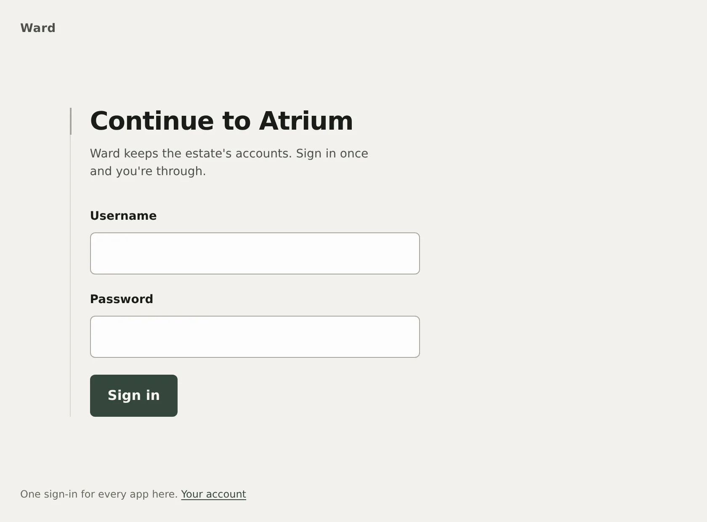
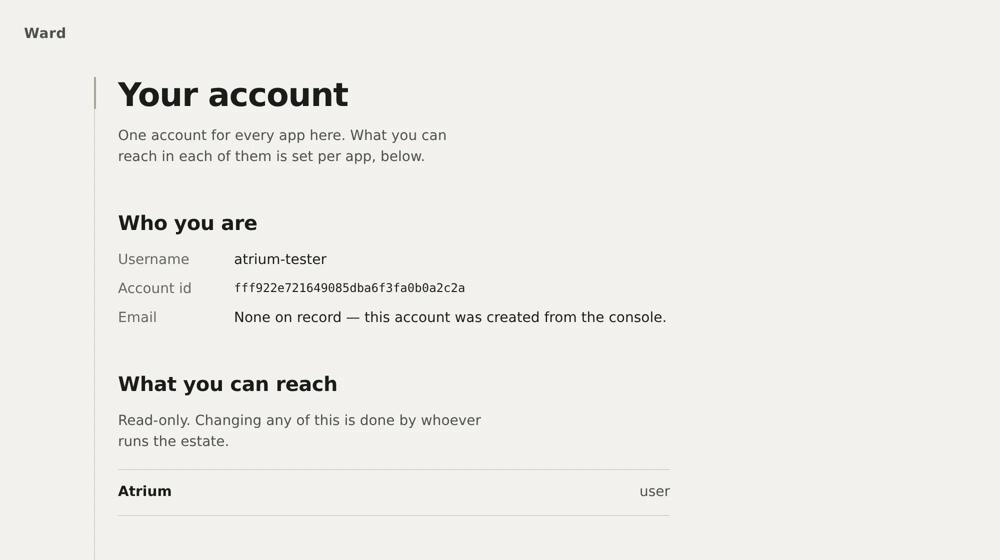
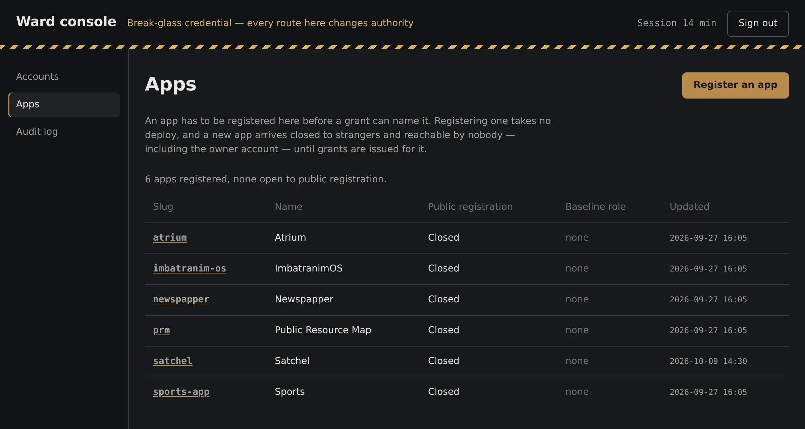
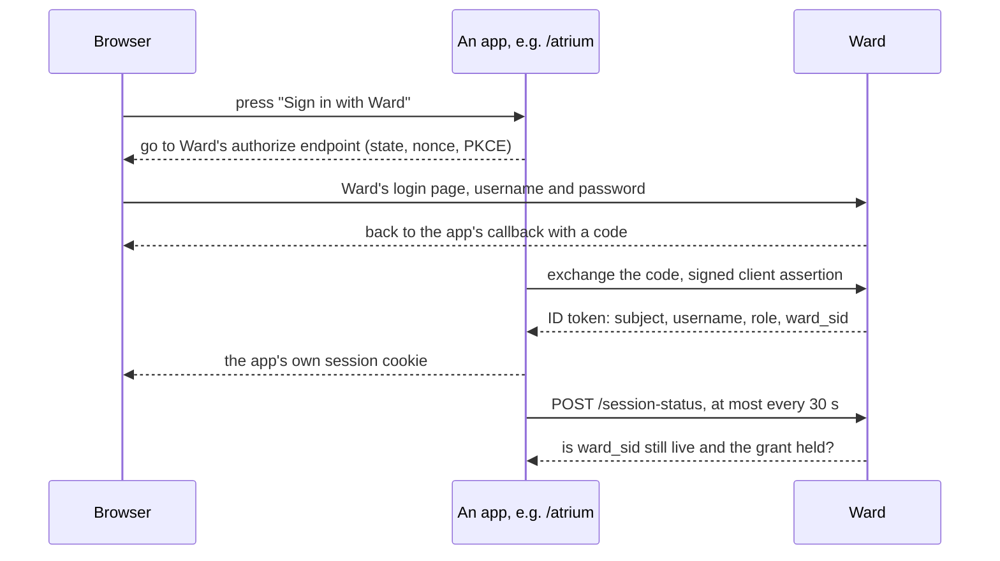

# Ward

The shared sign-in for the side projects on one production domain. Each app keeps its own accounts
and its own login page, and offers "Sign in with Ward" as a second way in. Ward is the OpenID
Connect provider behind that button, and a grant per app decides who may use it.

<p align="center">
  
</p>

**Status:** Personal project, in production since 2026-10-04 at `/ward/` on the production site. Since
2026-10-13 it is an OIDC provider: atrium, newspapper, public-resource-map and sports-app offer
"Sign in with Ward" beside their own login, and satchel is registered for local development. The GitHub repo is `gandolh/ward-auth` and the folder is still
called `wzd_auth`; the service is Ward ([why](corpus/wiki/overview.md#naming)).

## What it does

- Runs an OpenID Connect provider (authorization code with PKCE). An app's "Sign in with Ward"
  button sends the person to Ward's login page, and Ward sends them back with an ID token. Apps
  authenticate as clients with `private_key_jwt`; Ward stores only their public keys.
- Decides who may use each app's button with grants: an account, an app, a role. The role only
  seeds a new user's first role; after that the app owns it.
- Ends sessions in one place: signing out, "sign out my other devices" (a password change does the
  same), or a revoke from the admin console. Apps ask `POST /session-status` at most every 30
  seconds, so every session that began with Ward ends within 30 seconds. A spent refresh token
  that turns up again revokes the whole session, because that is what a stolen cookie looks like.
- Lets an app email its own Ward-linked users through `POST /notify` without seeing their addresses.
- Ships the code apps share, `shared-library/`: local accounts, sessions, the lockout, the Ward
  button and the 30-second check, as a built bundle each app copies in.

Apps keep working while Ward is down, through their own local sign-in. The design and what it
replaced are in [corpus/wiki/decisions-oidc.md](corpus/wiki/decisions-oidc.md).

## Screenshots

The account page shows a signed-in person who they are and which apps they can reach.



The admin console's app list, on a local copy of Ward. The console only accepts a break-glass login
set in Ward's environment; no account, not even the owner's, can reach it.



## How it works

Ward has two parts on one origin. The API at `/ward-api` is Fastify on SQLite and holds the one
Ed25519 signing key; the provider is mounted at `/ward-api/oidc`. The React UI at `/ward` has the
login, account and console pages. A Ward sign-in goes like this:



Rotation, the stolen-cookie alarm and the two-tab race that is not theft are on the docs site's
[Sessions and tokens](docs/src/content/docs/sessions.mdx) page. The full picture is
[Architecture](docs/src/content/docs/architecture.mdx).

## Run it locally

Requires Node 22 or later (`.nvmrc` pins 24), and Docker to run Ward itself.

```bash
npm install
npm test             # Vitest across api, ui and shared-library
npm run typecheck
npm run lint
npm run build
```

To run Ward with its UI, follow [infrastructure/local/README.md](infrastructure/local/README.md).
Docker Compose serves it at <http://localhost:8792>, and a seed script registers each app as an OIDC
client and writes its `WARD_OIDC_*` values into the app's local env file. Environment variables are
listed in [.env.example](.env.example).

## Project layout

| Path              | What lives there                                                                             |
| ----------------- | -------------------------------------------------------------------------------------------- |
| `api/`            | The Fastify API: the OIDC provider, sign-in, sessions, grants, mail, the console, migrations |
| `ui/`             | The React UI served at `/ward`: login, register, verify, account and the console             |
| `shared-library/` | The auth library apps vendor: local accounts and "Sign in with Ward"                         |
| `docs/`           | The docs site at `/ward/docs` (Starlight), plus the images in this README                    |
| `infrastructure/` | The container image and compose file; `local/` runs Ward in Docker                           |
| `corpus/`         | The project wiki: decisions, status and the briefs that built Ward                           |

## Docs

- [docs/](docs/README.md): what is in the docs folder, and the images used here
- Docs site: `/ward/docs/` on the production site, with the HTTP API, OIDC, the data model and
  configuration
- [Adoption guide](shared-library/README.md): how an app vendors the library and wires the Ward
  button
- [Project wiki](corpus/index.md): decisions, status and the briefs that built it

## License

No LICENSE file yet. `package.json` declares MIT.
